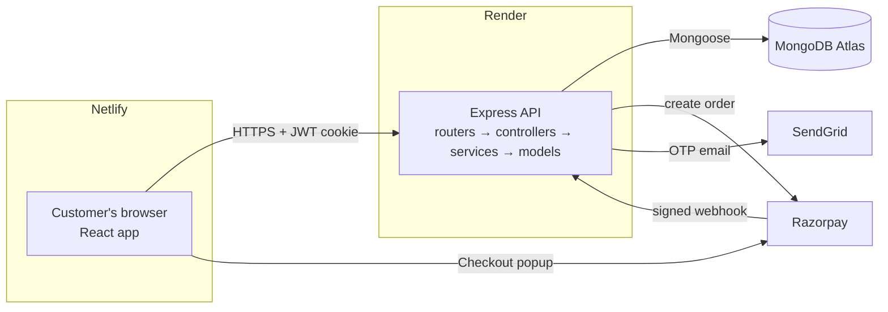
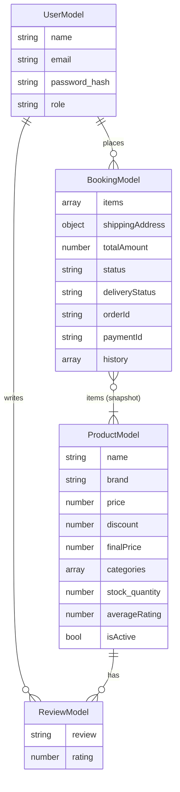
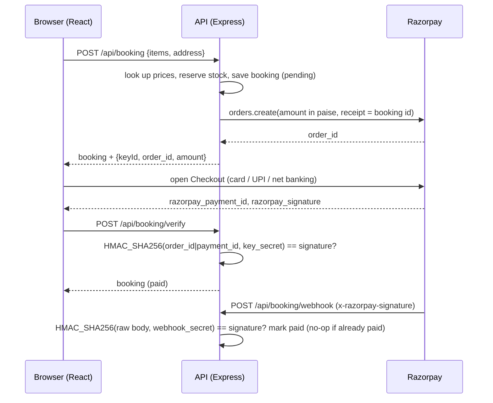
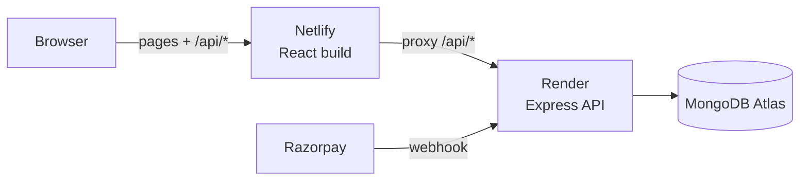

# ShopSphere – MERN E-commerce Application

ShopSphere is a full-stack online store built with **MongoDB, Express, React and Node.js** (the MERN stack), with online payments through **Razorpay**. It was built as the applied software project for the Scaler Neovarsity – Woolf MSc in Computer Science (Full Stack Specialization), following the structure taught in the course project.

Customers can browse and search products, add them to a cart, pay with Razorpay (cards, UPI, net banking, wallets), track their orders and review products they bought. Admins and sellers manage the catalogue, and admins manage orders from a dashboard.

---

## Features

**Customers**
- Sign up, log in, log out; forgot / reset password with an emailed 6-digit OTP
- 131 sample products in 10 categories, with search and pagination
- Filters for price (presets or custom range), brand (multi-select with counts), customer rating, discount and in-stock only, shown as removable chips and saved in the URL so filtered pages can be shared
- Sorting by newest, price, top rated or biggest discount – all searching, filtering and sorting is done by the database
- Product page with an image gallery, price, MRP, discount %, stock status and customer reviews
- Cart saved in the browser, with quantity limits based on stock
- Checkout with an Indian shipping address and Razorpay payment
- "My orders" with a status timeline; pay later or cancel an unpaid order
- Reviews and star ratings (only for products the customer has bought)

**Admins and sellers**
- Dashboard: revenue, paid / pending orders, customers, products, low-stock alerts, recent orders
- Add, edit, hide and restore products (sellers can only change their own products)
- Orders list with filters; mark orders shipped → delivered, or cancel them (admin only)

**Behind the scenes**
- Prices and totals are always calculated on the server
- Stock is reserved when an order is placed and released if it is cancelled or not paid within 30 minutes
- Payments are confirmed by checking Razorpay's signature (browser callback) *and* by a signed webhook; confirming twice has no extra effect

---

## Tech stack

| Layer | Technology |
|---|---|
| Frontend | React 19, Vite, React Router, Context API, axios, react-icons |
| Backend | Node.js, Express 4 |
| Database | MongoDB with Mongoose (MongoDB Atlas in production) |
| Payments | Razorpay (Orders API, Checkout, Webhooks) |
| Auth & security | bcrypt, JSON Web Tokens in httpOnly cookies, helmet, express-rate-limit, express-mongo-sanitize, xss, CORS allowlist |
| Email | Nodemailer via SendGrid SMTP |
| Testing | Node.js test runner, supertest, mongodb-memory-server |
| Hosting | Render (API), Netlify (frontend), MongoDB Atlas (database) |

---

## Architecture



### Folder structure

```
.
├── server/                     # Express REST API (CommonJS, as in the course)
│   ├── app.js                  # middleware + routes (exported for tests)
│   ├── server.js               # connects to MongoDB, starts the server, expiry job
│   ├── src/
│   │   ├── config/             # env.js (all settings), db.js (MongoDB connection)
│   │   ├── models/             # UserModel, ProductModel, BookingModel, ReviewModel
│   │   ├── controllers/        # AuthController, productController, bookingController, ...
│   │   ├── routers/            # AuthRouter, ProductRouter, BookingRouter, ReviewRouter, UserRouter
│   │   ├── middlewares/        # auth (protectRouteMiddleWare, isAuthorizedMiddleWare), errors, CSRF header
│   │   ├── services/           # paymentService (Razorpay), inventoryService (stock), bookingService
│   │   ├── utils/              # crudFactory, rateLimiter, dynamicMailSender, generateOtp, validators
│   │   ├── templates/          # otp.html email
│   │   └── seed_data/          # ProductsData.js + seed.js
│   └── test/                   # API tests
├── client/                     # React app (Vite)
│   └── src/
│       ├── routes/AppRoutes.jsx
│       ├── context/auth, context/cart     # AuthProvider/useAuth, CartProvider/useCart
│       ├── hooks/              # useFetchData, usePayment
│       ├── components/         # Header, Navbar, Product, AddToCart, CartItem, Pagination, ...
│       ├── pages/              # productListing, productDetail, cartItems, checkout, orders, login, admin, ...
│       └── utils/              # urlConfig, api (axios), format, razorpay
├── render.yaml                 # Render blueprint (backend)
└── netlify.toml                # Netlify config (frontend)
```

### Data model



---

## Running it locally

**Requirements:** Node.js 20 or newer. MongoDB does *not* need to be installed: when `MONGO_URI` is empty the API starts a local MongoDB automatically (the first start downloads it, about 75 MB).

```bash
npm run install:all
```

```bash
npm run dev
```

- Frontend: http://localhost:5173
- API: http://localhost:3001 (`/api/health` to check)

On start-up the development server adds any missing sample data. It never changes or deletes what's already there, so your local orders are kept. The sample data is:
- 20 products from the course data feed (`ProductsData.js`)
- 111 products from the open [dummyjson.com](https://dummyjson.com) dataset (`MoreProductsData.js`), each with 3 sample reviews owned by three demo reviewer accounts
- the demo accounts below (defined in `server/src/seed_data/seed.js`)

To fill a separate database such as Atlas, run `npm run seed --prefix server` with `MONGO_URI` set. `npm run seed --prefix server -- --reset` deletes all products and reviews first.

| Role | Email | Password |
|---|---|---|
| Admin | admin@shopsphere.test | Admin@12345 |
| Seller | seller@shopsphere.test | Seller@12345 |
| Customer | customer@shopsphere.test | Customer@12345 |

These are local test accounts only. Change them with `SEED_*_PASSWORD` before seeding any shared database.

### Configuration

Copy `server/.env.example` to `server/.env` (and optionally `client/.env.example` to `client/.env`). Everything is optional for local use:

| Variable | Purpose | If empty (development) |
|---|---|---|
| `MONGO_URI` | MongoDB connection string | Local MongoDB in `server/.mongo-data` |
| `JWT_SECRET` | Signs login tokens | Insecure dev secret (refused in production) |
| `CLIENT_URL` | Allowed frontend origin(s) for CORS | `http://localhost:5173` |
| `RAZORPAY_KEY_ID`, `RAZORPAY_KEY_SECRET` | Razorpay test/live keys | **Mock payment mode** |
| `RAZORPAY_WEBHOOK_SECRET` | Verifies webhook calls | Webhooks rejected |
| `SENDGRID_API_KEY`, `SENDER_EMAIL` | Sends OTP emails | OTP printed in the API terminal |

**Mock payment mode.** Without Razorpay keys, "Place order & pay" opens a test dialog to simulate a successful or failed payment, so the whole flow can be demoed with no account. With Razorpay test keys, the real Razorpay Checkout opens; use Razorpay's [test cards and UPI IDs](https://razorpay.com/docs/payments/payments/test-card-details/).

### Tests

```bash
npm test
```

29 API tests run against an in-memory MongoDB. They cover bcrypt hashing, cookies, role checks, NoSQL injection, the CSRF header, OTP reset, search and every product filter, filter counts, server-side pricing, shipping, stock reservation and release, order expiry, mock payments, forged Razorpay signatures, webhook signatures and idempotency, admin order flow and review rules.

---

## API reference

All responses use `{ status: "success" | "failure", message?, data?, pagination? }`. Requests that change data (POST/PATCH/DELETE) must send `X-Requested-With: XMLHttpRequest` (the frontend's axios instance does this).

| Method | Route | Access | Description |
|---|---|---|---|
| POST | `/api/auth/signup` | public | Create account, sets `JWT` cookie |
| POST | `/api/auth/login` | public | Log in, sets `JWT` cookie |
| GET | `/api/auth/logout` | public | Clear cookie |
| GET | `/api/auth/me` | user | Current user |
| PATCH | `/api/auth/forgetpassword` | public | Email a 6-digit OTP |
| PATCH | `/api/auth/resetPassword` | public | Reset password with email + OTP |
| GET | `/api/product` | public | List. Filters: `q`, `category`, `brand` (comma separated), `minPrice`, `maxPrice`, `minRating`, `minDiscount` (%), `inStock=true`. `sort`: `newest`, `price_asc`, `price_desc`, `rating`, `discount`. Paging: `page`, `limit` |
| GET | `/api/product/filters` | public | Brand counts and price range for the same filters (for the filter sidebar) |
| GET | `/api/product/categories` | public | Category names |
| GET | `/api/product/:productId` | public | One product |
| GET | `/api/product/admin/all` | admin, seller | List including hidden products |
| GET | `/api/product/admin/:productId` | admin, seller | One product including hidden |
| POST | `/api/product` | admin, seller | Create product |
| PATCH | `/api/product/:productId` | admin, seller (own) | Update product |
| DELETE | `/api/product/:productId` | admin, seller (own) | Hide product (soft delete) |
| GET | `/api/booking/config` | public | Payment mode and shipping rules |
| POST | `/api/booking` | user | Create order from cart, returns Razorpay order details |
| POST | `/api/booking/verify` | user | Verify Razorpay checkout signature |
| POST | `/api/booking/webhook` | Razorpay | Signed webhook (`payment.captured`, `order.paid`, `payment.failed`) |
| POST | `/api/booking/:bookingId/mock-pay` | user | Mock mode only |
| GET | `/api/booking/my` | user | My orders |
| GET | `/api/booking/:bookingId` | owner, admin | One order |
| GET | `/api/booking/:bookingId/pay` | owner | Payment details to retry |
| PATCH | `/api/booking/:bookingId/cancel` | owner | Cancel an unpaid order |
| GET | `/api/booking` | admin | All orders (`status`, `page`) |
| GET | `/api/booking/stats` | admin | Dashboard numbers |
| PATCH | `/api/booking/:bookingId/delivery` | admin | `shipped` / `delivered` |
| PATCH | `/api/booking/:bookingId/admin-cancel` | admin | Cancel (refund via Razorpay dashboard) |
| GET | `/api/review/:productId` | public | Reviews (paginated) |
| POST | `/api/review/:productId` | buyer | Add review |
| GET | `/api/user` | admin | All users |
| GET | `/api/user/:userId` | self, admin | One user |
| DELETE | `/api/user/:userId` | admin | Delete user |

---

## Payment flow (Razorpay)



- **Card data never reaches this server.** Customers enter payment details on Razorpay's Checkout, which is PCI DSS Level 1 certified. Because the store never sees or stores card numbers, its own PCI DSS obligations are typically the smallest self-assessment (SAQ A) rather than a full audit.
- **Two confirmations.** The browser callback gives instant feedback. The webhook still confirms the payment if the customer closes the tab or loses connection after paying.
- **Idempotent.** The "mark paid" update only matches a booking that is not paid yet, so duplicate webhooks and verify calls change nothing.
- **Amounts in paise.** Razorpay amounts are integers in the smallest unit (₹1 = 100 paise).

### Testing webhooks locally

Razorpay can't reach `localhost`, so use an HTTP tunnel such as ngrok:

```bash
ngrok http 3001
```

In the Razorpay dashboard (Test mode) go to **Settings → Webhooks → Add**, use `https://<your-ngrok-id>.ngrok-free.app/api/booking/webhook`, pick `payment.captured`, `payment.failed` and `order.paid`, and put the same secret in `RAZORPAY_WEBHOOK_SECRET`.

---

## Security measures

| Threat | Protection |
|---|---|
| Stolen password database | bcrypt with a per-password salt and cost factor 12; passwords and OTPs never returned by the API |
| Token theft through XSS | JWT stored in an **httpOnly** cookie (`Secure` + `SameSite=None` in production) |
| Cross-site request forgery | Write requests need an `X-Requested-With` header, which other sites can't send because of the CORS allowlist |
| Password guessing / OTP spam | `express-rate-limit`: 20 login/signup attempts per 15 min, 5 OTP emails per 10 min; max 5 wrong OTP tries |
| NoSQL injection (`{"$gt": ""}`) | `express-mongo-sanitize` plus type checks on every input |
| Stored XSS in reviews | `xss` package on the server; React escapes text when rendering |
| Price tampering | Server reads prices from the database; the browser only sends product ids and quantities |
| Forged payments | HMAC-SHA256 signature checks with constant-time comparison |
| Information leaks | `helmet` security headers, no `X-Powered-By`, no stack traces in production, same error for wrong email or password, no account enumeration in "forgot password" |
| Privilege escalation | Role always `user` at signup; `isAuthorizedMiddleWare([...])` on every admin route; sellers limited to their own products; customers can only see their own orders |
| Overselling | Atomic stock update (`stock_quantity >= qty`) when reserving |

### Changes from the course reference code

The project follows the course's structure and naming, with these fixes:

| Course code | Problem | This project |
|---|---|---|
| `password == user.password` | Plain-text passwords | bcrypt hashing; `confirmPassword` not stored |
| OTP returned in the forgot-password response | Anyone could reset any account | OTP sent only by email, stored hashed, expires in 10 min, 5 tries |
| Webhook HMAC over `JSON.stringify(body)`, `crypto` not imported | Signatures don't match / crash | HMAC over the raw body with `express.raw()` |
| `POST /verify` after `POST /:productId` | Route never reached | Routes ordered correctly, separate verify and webhook |
| Price sent by the browser | Customer can choose their own price | Prices from the database |
| Price and stock stored as `String` | Sorting and validation broken | Numbers, with validation |
| `default: Date.now()` | Date fixed at server start | `timestamps` / `Date.now` |
| `Access-Control-Allow-Origin: *` | Doesn't work with cookies | CORS allowlist with credentials |

---

## Deployment



The browser only talks to the Netlify site; Netlify forwards `/api/*` to Render (`client/public/_redirects`). This keeps the login cookie first-party, which matters because Safari and other privacy-focused browsers block cookies set by a different site. It also means `VITE_BASE_URL` stays empty.

1. **GitHub** – push this repository.
2. **MongoDB Atlas** – create a free (M0) cluster and a database user, and allow access from anywhere (Network Access → `0.0.0.0/0`), because Render's free plan has no fixed IP. Copy the connection string and add a database name, e.g. `...mongodb.net/shopsphere?retryWrites=true&w=majority`.
3. **Render (API)** – New → Blueprint → select the repo. `render.yaml` creates `shopsphere-api` and generates `JWT_SECRET`. Fill in:
   - `MONGO_URI` – the Atlas connection string
   - `RAZORPAY_KEY_ID`, `RAZORPAY_KEY_SECRET` – test or live keys
   - `SEED_ADMIN_PASSWORD` – password for `admin@shopsphere.test` (and optionally `SEED_CUSTOMER_PASSWORD`)
   - `CLIENT_URL` – your Netlify URL (you can fill this in after step 4)
   - optional: `RAZORPAY_WEBHOOK_SECRET`, `SENDGRID_API_KEY`, `SENDER_EMAIL`

   `SEED_SAMPLE_DATA=true` adds the sample catalogue on first start. Check `https://<service>.onrender.com/api/health`.
4. **Netlify (frontend)** – Add new site → Import from GitHub → this repo. `netlify.toml` sets base `client`, build `npm run build`, publish `dist`. The `/api` proxy and the single-page-app rule are in `client/public/_redirects`, which is copied into every build, so they work even if Netlify picks `client` as the base directory. If your Render URL isn't `https://shopsphere-api.onrender.com`, change it in `_redirects` and push.
5. **CORS** – set `CLIENT_URL` on Render to the exact Netlify URL (no trailing slash; comma-separate several).
6. **Razorpay webhook** (optional) – `https://<service>.onrender.com/api/booking/webhook` with `payment.captured`, `payment.failed` and `order.paid`, and the same secret in `RAZORPAY_WEBHOOK_SECRET`.

Note: Render's free plan sleeps after 15 minutes without traffic, and the first request after that takes around a minute. The frontend retries read requests while the API wakes up.

---

## Limitations and possible improvements

- Refunds are issued manually from the Razorpay dashboard (could use the Refunds API).
- Product images are links; uploading to cloud storage (e.g. Cloudinary or S3) would be better.
- No order confirmation emails, wishlist, coupons or inventory history.
- Cart is stored per browser, not per account.
- Search uses case-insensitive matching; a large catalogue would need MongoDB Atlas Search or a text index.
